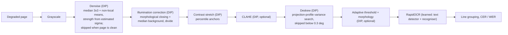

# DIP Project 004: Document-Image Enhancement for OCR on Insurance Claim Invoices

## 1. Problem

Scanned claim forms and invoices arrive skewed, unevenly lit, noisy, blurred or faint. This project asks which
classical image-processing stages make a modern OCR engine more accurate, and which do nothing or hurt.
OCR accuracy (CER/WER) is the measurable outcome.

## 2. Data

Synthetic A4 invoices (1240 x 1754 px, about 150 dpi) generated by `src/syntheticInvoiceGenerator.py`:
insurer title, claim/policy/date lines, a six-row item table, total, footer. Random fonts, names, amounts.
The exact text is known, so no manual labelling is needed. 20 documents, seed 2026.

Each document is degraded under 7 conditions (`src/imageDegradations.py`, parameters in `src/pipelineConfig.py`):
`clean`, `blur` (Gaussian sigma 2.2), `noise` (Gaussian std 28 + 2% salt-and-pepper), `unevenLight`
(directional brightness ramp), `lowContrast` (grey range 140-190), `skew` (3-8 degrees), and `combined`
(blur + contrast + light + skew + noise at 40% severity).

Limitation: synthetic data, one OCR engine. Results are not claimed to transfer to real scans.

## 3. Pipeline (block diagram)



DIP stages are in `src/enhancementStages.py`; the learned component is only the OCR engine, wrapped in
`src/ocrEngine.py` so another backend (e.g. Tesseract) can replace it.

Methods compared:

| Method | Stages |
|---|---|
| gray (baseline) | grayscale |
| otsu (classical baseline) | grayscale, global Otsu threshold |
| enhanced | gray, denoise, illumination, stretch, deskew |
| enhancedClahe | enhanced + CLAHE |
| enhancedBinary | enhanced + adaptive threshold + morphology |

## 4. How to run

```bash
python -m venv .venv
.venv/Scripts/pip install -r requirements.txt        # Windows; use .venv/bin/pip on Linux/macOS
.venv/Scripts/python src/runExperiment.py --docs 20 --seed 2026 --outputDir outputs
```

About 25 minutes on a CPU for 20 documents (the ablation adds extra runs). Outputs: `outputs/results.csv`
(per sample), `summary.csv`, `summary.md`, and the figures listed below. Run from the project root.

## 5. Results

Command that produced these numbers: `src/runExperiment.py --docs 20 --seed 2026` (see `outputs/summary.md`).
Mean character error rate over 20 documents per condition, lower is better:

| Condition | gray | otsu | enhanced | enhancedClahe | enhancedBinary |
|---|---|---|---|---|---|
| clean | 0.015 | 0.034 | 0.015 | 0.015 | 0.313 |
| blur | 0.024 | 0.657 | 0.019 | 0.017 | 0.258 |
| noise | 0.030 | 0.137 | 0.047 | 0.093 | 0.339 |
| unevenLight | 0.017 | 0.458 | 0.015 | 0.015 | 0.312 |
| lowContrast | 0.017 | 0.030 | 0.071 | 0.068 | 0.274 |
| skew | 0.264 | 0.266 | 0.016 | 0.016 | 0.039 |
| combined | 1.000 | 0.992 | 0.937 | 0.944 | 0.983 |

Word error rates are in `outputs/summary.md`. Other measured values for `enhanced` (`outputs/summary.csv`):
mean skew-estimation error 0.028 deg on `skew` and 0.081 deg on `combined`; PSNR/SSIM versus the clean page is
only defined when geometry is unchanged (blur 22.1 dB / 0.952, noise 26.3 dB / 0.666, uneven light 59.1 dB / 1.000,
low contrast 28.8 dB / 0.987).

Figures: `outputs/pipelineStages.png` (input and every intermediate stage), `outputs/beforeAfter.png`
(degraded input versus method outputs per condition), `outputs/cerByCondition.png`, `outputs/ablation.png`.

## 6. Analysis

Where DIP helps:
- **Skew:** deskew cuts CER from 0.264 to 0.016. The raw OCR cannot read rotated lines reliably; the
  projection-profile search recovers the angle to within 0.03 degrees on average.
- **Uneven light and blur versus the Otsu baseline:** a global threshold fails (CER 0.458 and 0.657); illumination
  correction plus the rest of the pipeline brings these to 0.015 and 0.019.

Where it does not help (reported honestly):
- **Against the untouched grayscale image, enhancement gives no gain on clean, blur and uneven-light pages.** The
  deep-learning OCR already tolerates them (0.015-0.024).
- **Noise and low contrast get worse with enhancement** (noise 0.030 to 0.047, low contrast 0.017 to 0.071). The
  denoise and stretch stages remove or distort faint strokes; this was not investigated further.
- **Binarization hurts a deep OCR badly** (0.31 on clean pages) because it destroys the grey-level cues the
  recogniser uses. Thresholding is usually meant for classical OCR engines; that was not tested here.
- **Combined degradation is a failure case for every method** (CER 0.94-1.00). The worst-case table in
  `outputs/summary.md` lists only combined pages, where OCR returned no text at all.
- The leave-one-stage-out ablation on `combined` (`outputs/ablation.png`) is uninformative: every variant sits
  at CER 0.98-0.99 except removing adaptive thresholding (0.909). This is a floor effect, not evidence that
  the other stages are unnecessary.

## 7. Process notes and limitations

- Pipeline parameters were adjusted after inspecting pilot pages of the same synthetic generator (combined
  severity lowered, denoise and deskew skipped on clean pages, contrast-stretch anchors changed). No separate
  held-out set was used, so numbers are optimistic for the tuned stages.
- One OCR engine (RapidOCR), synthetic documents, 20 pages per condition. CER ignores whitespace; WER does not.

## 8. Team contribution

Team: Shubham Verma (23CS3052) and Digdarshan Mishra (23CS3024). Both members can explain the complete pipeline.

| Area | Files | Lead |
|---|---|---|
| Synthetic invoice generation and the six degradations | `syntheticInvoiceGenerator.py`, `imageDegradations.py`, `imageRotation.py` | Shubham Verma |
| Evaluation: OCR wrapper, CER/WER, PSNR/SSIM, experiment runner | `ocrEngine.py`, `evaluationMetrics.py`, `runExperiment.py` | Shubham Verma |
| DIP enhancement stages and pipeline composition | `enhancementStages.py`, `enhancementPipeline.py`, `pipelineConfig.py` | Digdarshan Mishra |
| Results analysis: figures, ablation, failure cases, report | `experimentReport.py`, `outputs/`, this README | Digdarshan Mishra |
